<p align="center">
  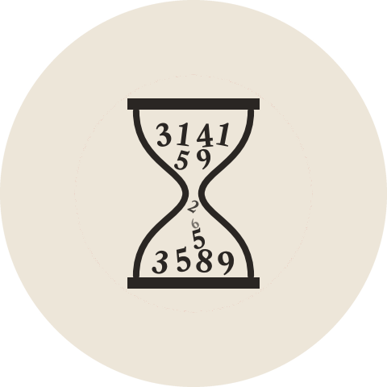
</p>

<p align="center">
  
</p>

<p align="center">
  <b>An Android app for practicing number memorization.</b><br>
  <sub>VIVI OGNI GIORNO COME SE FOSSE IL PRIMO</sub>
</p>

<p align="center">
  
  
  
  
  
</p>

<p align="center">
  <a href="#features">Features</a> ·
  <a href="#get-started">Get started</a> ·
  <a href="#license">License</a> ·
  <a href="#credits">Credits</a>
</p>

<br>

<table align="center">
  <tr>
    <!-- <td align="center">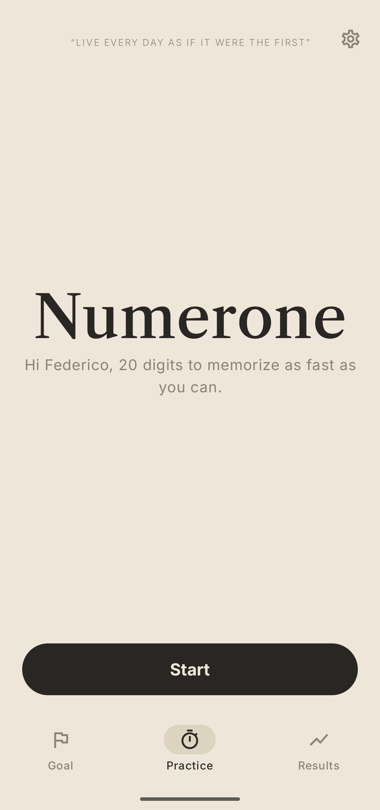</td> -->
    <td align="center">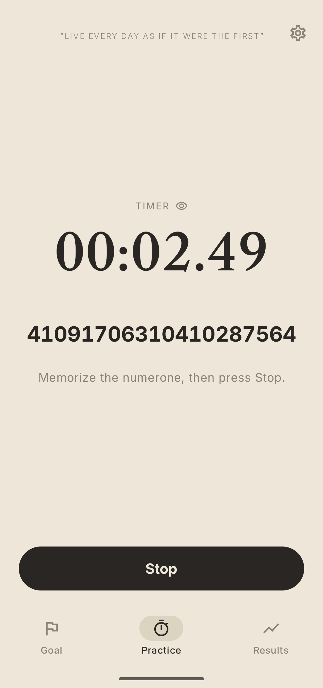</td>
    <td align="center">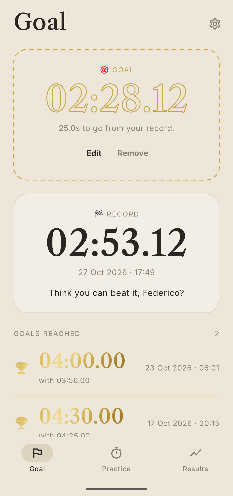</td>
    <td align="center">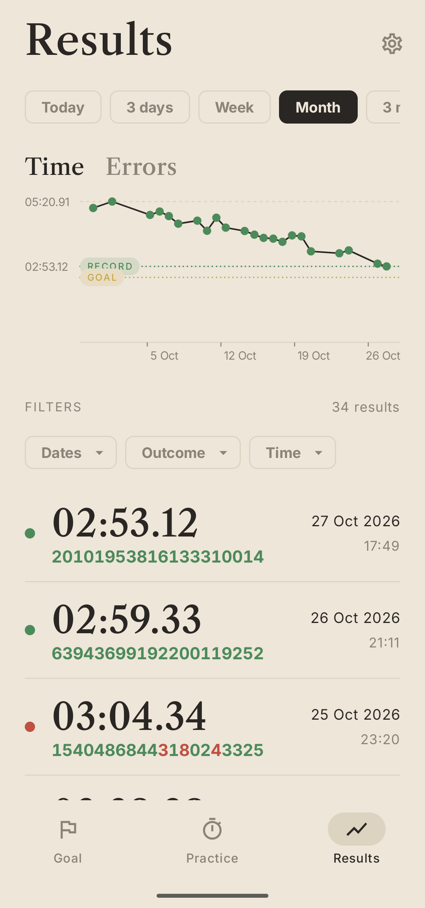</td>
  </tr>
  <tr>
    <!-- <td align="center">Start a run</td> -->
    <td align="center">Memorize the Numerone</td>
    <td align="center">Set your goal</td>
    <td align="center">Monitor your progress</td>
  </tr>
</table>

<br>

Memorizing a long number sounds like a party trick, until you learn how to do it, and it becomes a party trick but that you never believed possible! Practice the numerone: the app gives you the 20-digit number, it handles timing you and checking your answer. If your answer it's correct, it saves your score, and tracks it over time.

<br>

<table>
  <tr>
    <td width="25%" valign="top">
      <h3>🔢 Roll your luck</h3>
      The number is generated so pairs do not repeat, making sure you can memorize it correctly.
    </td>
    <td width="25%" valign="top">
      <h3>⏱️ Track your time</h3>
      The app tracks the time of each perfect answer, but you can also track how many mistakes you make.
    </td>
    <td width="25%" valign="top">
      <h3>🏆 Set your goals </h3>
      Set a goal, and track your goals over time. Periodic notifications remind you to practice!
    </td>
    <td width="25%" valign="top">
      <h3>🔒 Fully portable</h3>
      The app requires no account, no permissions and no internet. It stays fully local, and you can reset your times whenever you want.
    </td>
  </tr>
</table>

<br>

## Features

<table>
  <tr>
    <td width="50%" valign="top">
      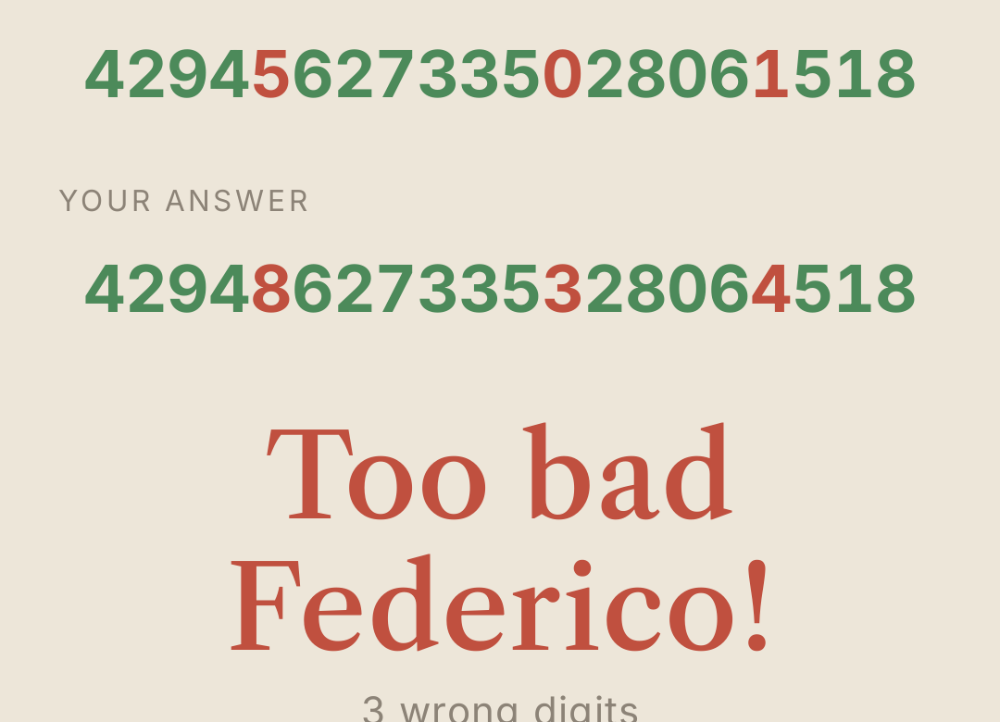
      <br>
      <sub></sub>
      <h3>Check digits</h3>
      Your answer is lined up under the original number and checked digit by digit, revealed one at a time. Right digits are green, wrong ones red, and the app counts the mistakes for you and tracks them.
    </td>
    <td width="50%" valign="top">
      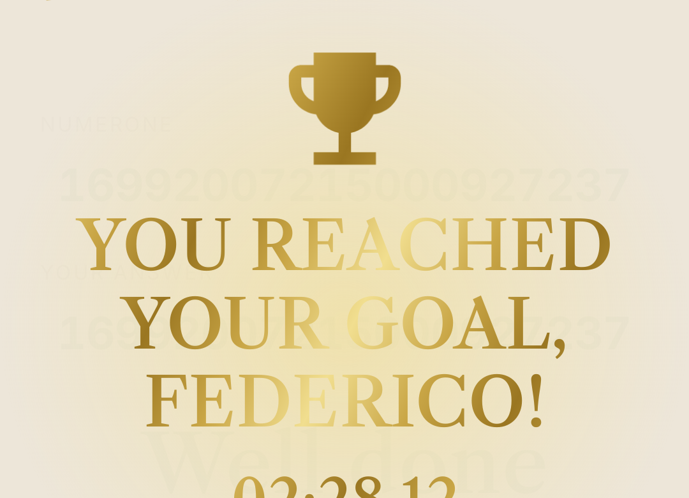
      <br>
      <sub></sub>
      <h3>Goal celebration</h3>
      When you reach your goal, the app plays a celebration! A trophy, confetti and a round of applause follow, and the goal moves to your shelf of reached goals.
    </td>
  </tr>
  <tr>
    <td width="50%" valign="top">
      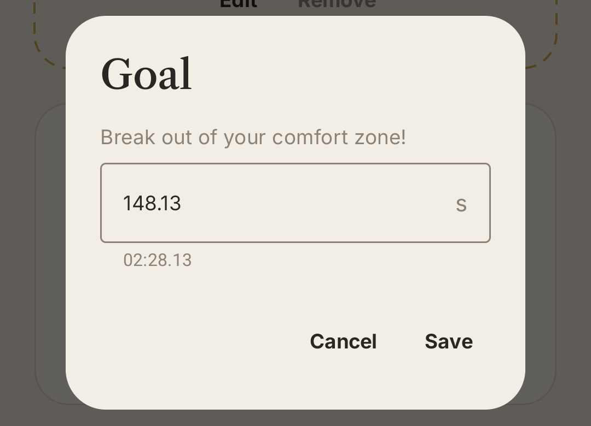
      <br>
      <sub></sub>
      <h3>Set your goal</h3>
      Input the goal you want to reach. Each time you open the dialog, a new motto pushes you to aim higher.
    </td>
    <td width="50%" valign="top">
      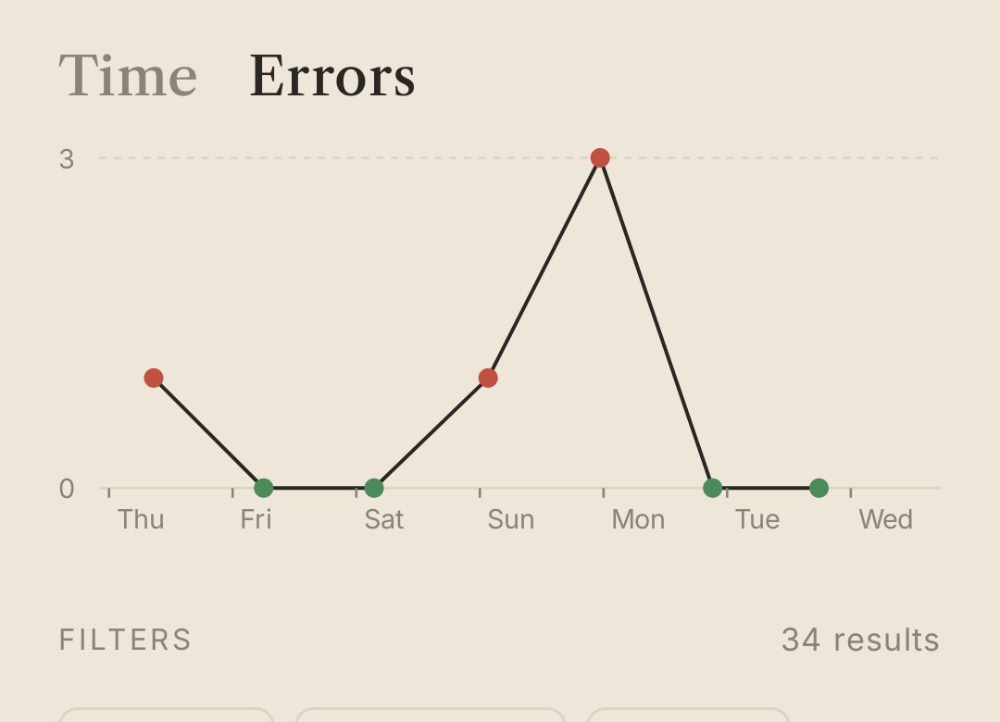
      <br>
      <sub></sub>
      <h3>Mistakes tracking</h3>
      Switch the hart from Time to Errors to see how many digits you missed in each run over time. Green dots are perfect runs. Pick any period from today to a year, or the whole history.
    </td>
  </tr>
  <tr>
    <td width="50%" valign="top">
      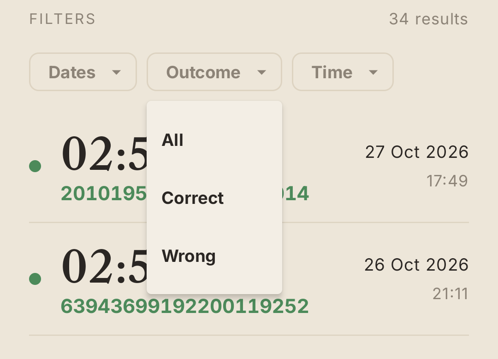
      <br>
      <sub></sub>
      <h3>Filter your results</h3>
      Narrow the history by date range, by outcome (correct or wrong) or by runs under or over a time. The list counts the results as you filter.
    </td>
    <td width="50%" valign="top">
      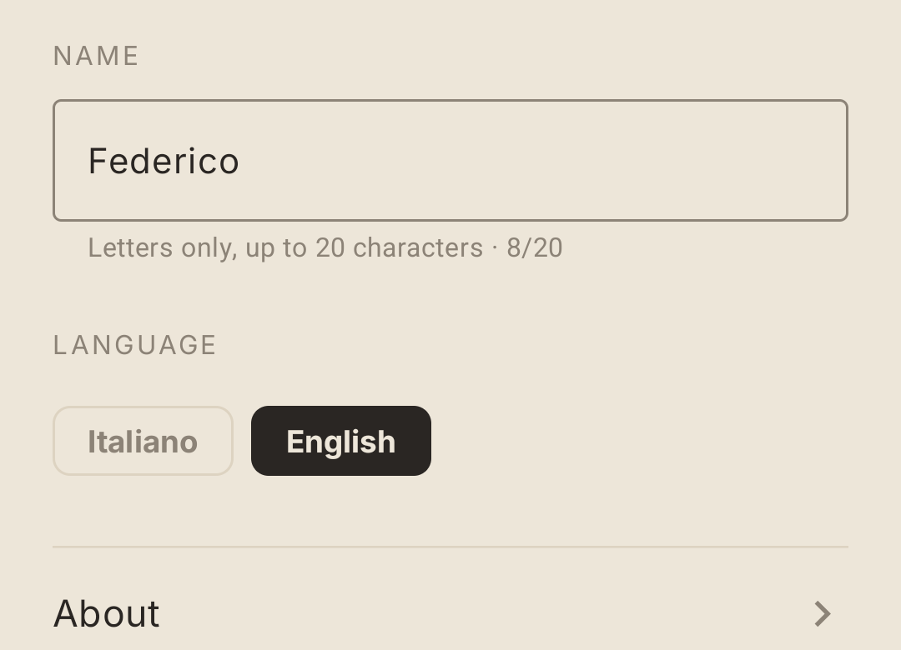
      <br>
      <sub></sub>
      <h3>Input your name</h3>
      Numerone greets you by name, up to 20 letters, so it feels more personal. Switch between English and Italian whenever you like. Settings also has an About page and a button that deletes all your results.
    </td>
  </tr>
</table>

<br>

## Get started

You need Android Studio, or a recent JDK with the Android SDK, and a device or emulator running Android 8.0 or later.

```bash
git clone <this-repo>
cd Numerone
./gradlew installDebug   # build and install on a connected device or emulator
./gradlew test           # unit tests for the number logic
```

On Windows, use `gradlew.bat`. If Android Studio hasn't done it for you, point `local.properties` at your SDK:

```properties
sdk.dir=/path/to/Android/Sdk
```

The code lives in `app/src/main/java/it/numerone`:

| File | Contents |
| --- | --- |
| `Numerone.kt` | Number generation, time formatting, goal logic |
| `Practice.kt` | The run: memorize, recall, check, celebrate |
| `Goal.kt` | Target time, record, reached goals |
| `Results.kt` | Charts, filters and history |
| `Settings.kt` | Name, language, data deletion, About |
| `Strings.kt` | All texts, in Italian and English |
| `MainActivity.kt` | Theme, storage and tab navigation |

The launcher icon comes from `tools/make_icon.py`, which draws the hourglass from the app's own serif digits (it needs `fontTools`).

<br>

## License

*Numerone* is licensed under MIT. Copyright (c) 2026 Federico Coscia

## Credits

The app draws on the memorization course and techniques of [Vincenzo Palmisano](https://vincenzopalmisano.net) and 6inTempo S.p.A. For the method itself and everything beyond this small practice tool, visit [vincenzopalmisano.net](https://vincenzopalmisano.net).

*Numerone* is an independent project by enthusiasts of the course and of memorization techniques. It is an open-source project and is not affiliated with, sponsored by or endorsed by Vincenzo Palmisano or 6inTempo S.p.A. For more information about them and their memorization techniques, please visit [vincenzopalmisano.net](https://vincenzopalmisano.net).
